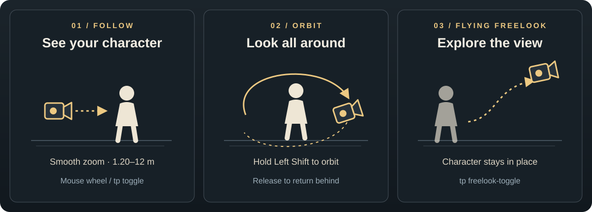

<p align="center">
  
</p>

# Third Person View

**See your character. Orbit freely. Fly through the loaded world.**

Third Person View adds an adjustable third-person camera, held orbit and flying
freelook to the **Wurm Unlimited client**. Current release: **0.4.9**.

**[Download the latest release ZIP](https://github.com/chamomilo/WU-3rd-person-view/releases/latest)**
 · [Release notes](CHANGELOG.md) · [Installation guide](README.txt)

## Three ways to look around



*Camera behavior illustrated schematically.*

- **Third person:** follow the character's animated eye position with smooth
  zoom from 1.20 to 12 metres. Scroll closer at the nearest distance to return
  to first person.
- **Orbit:** hold Left Shift to look around without turning the character.
  Release it to smoothly return the camera behind the character.
- **Flying freelook:** move the camera independently while the character stays
  in place. A click-through **FREE LOOK MODE** marker shows when it is active.
- **World-aware camera:** terrain, vegetation, objects, lighting and cave
  visibility follow the camera within the world data already loaded by Wurm.
  Cave floors, ceilings and solid walls constrain movement.

## Install

Requires the Wurm Unlimited client and a compatible
[Wurm client mod launcher](https://github.com/ago1024/WurmClientModLauncher).

1. Close the entire Wurm Unlimited client.
2. Extract the release ZIP into the client directory containing
   `WurmLauncher.exe`. Merge its `mods` folder with the existing one.
3. Start the client through the mod launcher, enter the world and run
   `tp status` in the console.

The ZIP contains exactly these four files:

```text
mods/
  WU-third_person_view.properties
  WU-third_person_view/
    WU-third_person_view.jar
    README.txt
    keybinder/
      WU-third_person_view.keybinder
```

When updating, back up your customized `.properties` file and reapply the camera
settings you want after extraction. The ZIP does not contain your saved
`state.properties`. Use one third-person camera mod at a time.

## Controls

[Keybinder](https://github.com/chamomilo/wurm-keybinder) is optional. Compatible
versions expose the **Catalog: 3rd Person View** actions for assigning keys.
You can also import the bundled `.keybinder` preset to use these bindings:

| Preset binding | Action |
| --- | --- |
| **V** | Toggle first-person / third-person view |
| **Mouse Wheel Up / Down** | Zoom in / out |
| **Home** | Reset the camera behind the character |
| **Left Shift**, held | Orbit without turning the character |
| **F8** | Toggle flying freelook |

Without Keybinder, the mod handles the mouse wheel and the configured orbit key
(`LSHIFT` by default). Invoke other actions through the console.

In flying freelook, mouse look aims the camera and your normal forward, back,
left and right movement bindings fly it. **Shift** accelerates; **Alt** slows
movement for precision. Leaving freelook restores the previous view mode.

## Console commands

| Command | Action |
| --- | --- |
| `tp toggle`, `tp on`, `tp off` | Toggle, enable or disable third person |
| `tp zoom-in`, `tp zoom-out` | Adjust camera distance |
| `tp zoom <0..1>` | Set zoom from nearest (`0`) to farthest (`1`) |
| `tp reset` | Reset orbit behind the character |
| `tp orbit-hold` | Held orbit action for Keybinder |
| `tp orbit-on`, `tp orbit-off` | Start or stop orbit explicitly |
| `tp freelook-toggle` | Toggle flying freelook |
| `tp freelook-on`, `tp freelook-off` | Start or stop flying freelook |
| `tp status` | Show the current camera state |
| `tp debug on`, `tp debug off` | Enable or disable diagnostic logging |

## Settings and updates

Edit `mods/WU-third_person_view.properties` while the client is closed to adjust
zoom, smoothing, collision, head animation and orbit. View mode and zoom are
saved separately in `mods/WU-third_person_view/state.properties`.

Release 0.4.9 embeds **Chamomilo updater 1.4.1** with **Chamomilo UI 0.4.11**.
Participating mods share one update registry; the newest compatible embedded
updater is selected at startup. The registry shows mod logos, checks GitHub
releases and opens release pages. **Install release ZIPs manually.**

The shared language selector supports English, Brazilian Portuguese, German
and Russian and applies immediately to capable installed mods. Its initial
choice follows a supported OS language, with English fallback. Camera commands
and camera messages remain in English.

## Troubleshooting and limits

- **Unknown `tp` command:** enter the world first, check the extraction paths
  and `client.log`, then restart the entire client. Initialization logs
  `WU-third_person_view 0.4.9 hooks installed` and
  `WU-third_person_view ready`.
- **Camera stops at a boundary:** Wurm streams world data around the character.
  Moving the camera does not request a new region. A separate cave is accessible
  only when its tile data and floor corners are already loaded.
- **Tight spaces:** the camera temporarily falls back to first person when
  there is too little room, preserving the selected zoom.
- **Collision fallback warning:** if Wurm's advanced collision manager is
  unavailable, terrain and cave checks remain active; surface object and
  building wall collision is not guaranteed.

## Build from source

Use a **Java 8 JDK** and the included **Gradle 5.3.1** wrapper. Supply the local
client and test dependencies listed in [libs/README.md](libs/README.md).
The canonical updater source must be available at `C:/projects/updater`, or set
`CHAMOMILO_UPDATER_REFERENCE` or `-PchamomiloUpdaterReference=/path/to/updater`.

Set `WURM_JFX`, `WURM_JAVAFX_JAR` or `-PwurmJavaFxJar` to a JavaFX 8
`jfxrt.jar` for the updater's native UI checks, then run on Windows:

```powershell
.\gradlew.bat clean build dist verifyClientContract
```

The build checks the complete updater, client contracts, exact embedded module
contents and the four-file ZIP layout. Output:
`build/distributions/WU-third_person_view-0.4.9.zip`.
Rendering and camera transitions also need testing in a running client.

## License

Copyright (C) 2026 chamomilo. Original project source and documentation are
licensed under [GNU GPL version 3](LICENSE). The release JAR contains the full
license at `META-INF/LICENSE.txt`; bundled fonts retain their OFL license.
Wurm Unlimited client files and third-party build dependencies are excluded.
